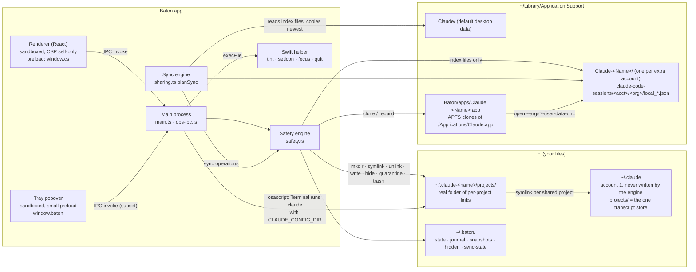

# Baton architecture

This document describes how Baton is built, for engineers who want to check its claims against the code. Every
statement here points at a file and, where it matters, a function. Where the code does less than you might hope,
this document says so.

Baton is an Electron app (main process in TypeScript, renderer in React) with a small Swift helper. The main-process
logic is about 5,800 lines in [`electron/`](electron/); the safety engine alone is
[`electron/safety.ts`](electron/safety.ts). There is no server.

- [1. The problem in technical terms](#1-the-problem-in-technical-terms)
- [2. System overview](#2-system-overview)
- [3. Key design decisions](#3-key-design-decisions)
- [4. The safety engine](#4-the-safety-engine)
- [5. Threat model and privacy](#5-threat-model-and-privacy)
- [6. Fair-use guardrails](#6-fair-use-guardrails)
- [7. Testing](#7-testing)
- [8. Known limitations](#8-known-limitations)
- [9. Release and signing](#9-release-and-signing)

---

## 1. The problem in technical terms

Claude Code keeps everything for a sign-in in one config directory. The default is `~/.claude`. Setting
`CLAUDE_CONFIG_DIR=<dir>` gives a second, independent sign-in, and with it a second, independent history:

```
~/.claude/projects/<encoded cwd>/<session-id>.jsonl        account 1's transcripts
~/.claude-work/projects/<encoded cwd>/<session-id>.jsonl   account 2's transcripts (a different folder)
```

`<encoded cwd>` is the project path with every non-alphanumeric character replaced by `-`
(`encodeProject` in [`electron/roots.ts`](electron/roots.ts) and [`electron/core.ts`](electron/core.ts)). So when
account 1 hits its limit mid-task, `claude --continue` under account 2 finds nothing: the transcript is in the other
account's folder.

The Claude desktop app has a second version of the same problem:

- The desktop app is an Electron app with **one sign-in per user-data directory**
  (`~/Library/Application Support/Claude`). A second account needs a second data directory, which Electron supports
  via `--user-data-dir`.
- Its Code tab runs an embedded `claude` **without** `CLAUDE_CONFIG_DIR`, so every desktop transcript, from every
  profile, lands in `~/.claude/projects` (verified on Claude desktop 3.6556 / claude-code 2.1.308; see the header
  comment of [`electron/sharing.ts`](electron/sharing.ts)).
- What decides whether a desktop app's sidebar shows a chat is a separate, per-profile index:
  `<profile>/claude-code-sessions/<accountUuid>/<orgUuid>/local_<id>.json`, one small JSON file per session
  (`cliSessionId`, `title`, `cwd`, `spawnedFrom`, ...). The app rewrites these files by **atomic rename**
  (write a temp file, rename over the old one). This format is undocumented.

Baton's job: let one person's own accounts continue the same project history, in Terminal and in the desktop app,
without copying credentials and without ever risking the transcripts themselves.

## 2. System overview



Components:

| Part | Where | Role |
|---|---|---|
| Main process | [`electron/main.ts`](electron/main.ts) | Window, tray, launch gate, usage checks, IPC for reads and launches. |
| Write IPC | [`electron/ops-ipc.ts`](electron/ops-ipc.ts) | Every write: `opPlan` builds an operation and returns its preview; `opApply` runs it through the engine. Serialized: one write at a time (`serial`). |
| Safety engine | [`electron/safety.ts`](electron/safety.ts) | Guard list, snapshots, journal, apply, verify, rollback, restore, undo. |
| Sharing + sync | [`electron/sharing.ts`](electron/sharing.ts) | Per-project links, desktop index sync, hide/restore, migration from the old whole-folder sharing, Doctor. |
| Desktop apps | [`electron/desktop.ts`](electron/desktop.ts), [`electron/apps.ts`](electron/apps.ts) | APFS clones, launch with `--user-data-dir`, pairing apps with accounts by email, merge & tidy up. |
| Fair use | [`electron/fairuse.ts`](electron/fairuse.ts) | Account kind, attestation, suspension detection, usage gate, launch gate. |
| Usage | [`electron/usage.ts`](electron/usage.ts), [`electron/usage-hook.ts`](electron/usage-hook.ts) | `claude -p /usage` and `claude auth status`, parsed; optional status-line capture, planned as engine operations (`usage-hook-on` / `usage-hook-off`). |
| Roots | [`electron/roots.ts`](electron/roots.ts) | Every filesystem root in one overridable place (tests point it at a fake HOME), plus read-only mode. |
| Swift helper | [`helper/baton-desktop-helper.swift`](helper/baton-desktop-helper.swift) | 100 lines of AppKit: hue-rotate an `.icns`, set a Finder icon, focus or politely quit an app by pid. |

State lives in `~/.baton/` (`~/.claude-switch/` on installs made under the old name; `resolveAppDir` in
`roots.ts` keeps using an old folder in place rather than moving it).

## 3. Key design decisions

Each decision below lists what was rejected and why.

### Per-project links, not a link of the whole `projects/` folder

**Chosen:** account X's `projects/` is a real folder. Sharing project P with X adds exactly one symlink,
`~/.claude-x/projects/<enc P> → ~/.claude/projects/<enc P>` (`shareTerminalSteps` in `sharing.ts`). `claude` running
under X writes new transcripts through the link straight into the canonical store, so there is nothing to sync for
Terminal sessions.

**Rejected:** making `~/.claude-x/projects` one symlink to `~/.claude/projects`. Early versions did this. It shares
every project, including ones that should stay on a personal account, and cannot be narrowed. Baton still detects it
(`terminalState` returns `legacy-all`; Doctor warns) and ships a previewed, undoable migration (`planMigration`) that
turns it into per-project links.

When an account already has its own history for a project (`private-history`), sharing adds its files to the store
**only where the store has no file of that name** (never overwrites; differing files are counted and stay in the
private copy), then renames the private folder to `<enc>.private-<timestamp>` next to the new link.

### APFS clone + `--user-data-dir`, not patching Claude

**Chosen:** each extra desktop account gets `~/Library/Application Support/Claude-<Name>/` as its data folder and its
own copy of Claude.app at `~/Library/Application Support/Baton/apps/Claude <Name>.app`, made with `cp -Rc`
(APFS copy-on-write, so it costs almost no disk), launched as
`open <clone> --args --user-data-dir=<data folder>` (`buildClone`, `openProfile` in `desktop.ts`). The copy is
byte-identical: same bundle id, same signature. The colored icon is a Finder custom icon (metadata outside the code
seal), so `codesign --verify` still passes and the Keychain keeps trusting the app. When `/Applications/Claude.app`'s
`CFBundleShortVersionString` changes, clones are rebuilt from scratch (`ensureClone`, Doctor's "profiles" check).

**Rejected:** modifying the Claude bundle, injecting code, or editing its resources. That breaks Anthropic's
signature and Keychain trust, and modifying Claude is something Baton refuses to do on principle (see
[FAIR-USE.md](FAIR-USE.md)). Also rejected: launching `/Applications/Claude.app` itself with a different
`--user-data-dir`. It works, but every account then shares one app in Finder and the Dock, with the same icon, so
there is nothing to tell them apart or to launch a specific account from.

One consequence of identical bundle ids: Claude's login hands the token back over a `claude://` URL, and macOS
delivers it to whichever Claude app is running. Baton handles this with a "first sign-in" flow that asks the other
Claude apps to quit (with a confirm) before opening an unsigned-in profile (`desktopOpen` handler in `main.ts`).

### Mirror whole index files, newest wins, loser kept. No merging

**Chosen:** for each shared project, the sync engine (`planSync` in `sharing.ts`) mirrors the `local_*.json` files
whose `cwd` is inside the project between the participating desktop folders. Per file:

1. Read only when stable: `stat`, read, `stat` again; size and mtime must match and the bytes must parse as JSON
   (`readStable`). A file mid-write is skipped until the next pass.
2. Compare against the last synced hash (`~/.baton/sync-state.json`). Among the versions that changed since, the
   newest mtime wins (ties broken by hash, so the result is deterministic).
3. Every write is a normal engine operation, so each overwritten version is in that operation's snapshot. A sync
   with conflicts is **pinned** (never pruned) and raises a notification.
4. Deletions do not propagate. A file removed in one folder is not removed elsewhere and is not re-added where it
   was removed.
5. Folders of a running desktop app are only read; writes to them are deferred until it quits.

Sync runs from `fs.watch` on the participating folders (1.5 s debounce, because the app writes in tmp+rename
bursts), a 30 s pass, and a watcher refresh every 120 s (`restartWatchers`, `syncPass` in `ops-ipc.ts`).

**Rejected:**

- *Per-file symlinks.* The app saves by atomic rename, which replaces a symlink with a regular file on the first
  write.
- *A symlink on the `<acct>/<org>` folder.* This survives renames and was the old approach (still recognised as
  legacy and migrated away). It shares every project's chats at once, like the whole-`projects/` link.
- *Field-level JSON merging.* The format is undocumented and changes with Claude releases. Copying whole files
  treats them as opaque, so a new field Baton has never seen is carried along intact.

### Never read tokens or the Keychain

Baton has no code that calls the Keychain or reads a credential value. Where it must look at a file that also holds
secrets, it parses the JSON and copies out an allow-list:

- `readEmail` (`core.ts`): `oauthAccount.emailAddress` only.
- `readKindHints` (`fairuse.ts`): `organizationType`, `billingType`, `organizationRole`, `workspaceRole` only
  (`KIND_HINT_KEYS`), each truncated to 60 characters.
- `signInOf` (`desktop.ts`): the desktop `config.json`'s `lastKnownAccountUuid`, plus whether a token-cache key
  **exists**. The value is not used.
- `listClaudeProcesses` (`core.ts`): reads running `claude` processes' environments with `ps -E` to learn
  `CLAUDE_CONFIG_DIR`, `CLAUDE_CODE_USER_EMAIL` and `CLAUDE_CODE_ENTRYPOINT`. The environment can contain tokens, so
  `pickEnv` extracts those three keys and the string is overwritten immediately.

The honest limit: those files are parsed in full in memory before the allow-list is applied. Nothing else is kept,
logged or sent, and diagnostics export redacts `sk-ant-…` strings, token fields and emails (`redact` in
`ops-ipc.ts`).

Sign-ins are never copied. Each account and each desktop app signs in through Claude's own flow.

Baton also scrubs its own environment at startup (`scrubOwnEnv`, `cleanEnv`, `SCRUB_RE` in `core.ts`). If Baton was
started from inside a Claude session, it inherits `CLAUDE_*`/`ANTHROPIC_*` variables, including an OAuth token, and
any child `claude` would sign in as that session's account regardless of `CLAUDE_CONFIG_DIR`. Every spawn uses a
cleaned environment, and the Terminal launch script unsets those variables again before `exec claude`
(`writeLaunchScript`).

### No server, no telemetry; one optional update check

The Baton process makes exactly one kind of network request of its own: the in-app update check against GitHub
Releases (below). There is no analytics, crash reporter or Baton server; see
[section 5](#5-threat-model-and-privacy) for the full list of what does touch the network.

### In-app updates: electron-updater + Squirrel.Mac, from GitHub Releases only

**Chosen:** [electron-updater](https://www.electron.build/auto-update) with the GitHub provider
(`vamsijanaki/baton`), which on macOS hands the downloaded `.zip` to Squirrel.Mac. Decisions live in
[`electron/update-logic.ts`](electron/update-logic.ts) (no Electron, no network; tested with a fake clock), the wiring
in [`electron/updater.ts`](electron/updater.ts), the UI in Settings › Updates.

- **When.** "Check for updates automatically" (`autoUpdateCheck` in `settings.json`, default on): one check when
  Baton starts, then at most once a day (`shouldCheck`; an hourly timer only looks at the clock). Off: nothing is
  contacted unless you press Check now. The last check time is kept in `~/.baton/update.json`.
- **Never** in a dev or unsigned/ad-hoc build ("Updates are only available in signed releases"), in dry-run mode
  (`BATON_DRY_RUN`), against a fake HOME (tests, `npm run shots`), or when running from the disk image or a
  translocated copy (`updateSupport`). The running app's signature is read locally with `codesign -dv`; it must be
  Developer ID, team `D9S4VXPF9P`, bundle id `com.vamsijanaki.baton`. electron-updater is not even loaded otherwise.
- **No silent installs.** `autoDownload` and `autoInstallOnAppQuit` are off. The user presses "Download and install"
  (progress shown), then "Restart to update". No popups or notifications; a small "Update available" line in the
  sidebar footer and the tray popover footer is the only hint.
- **Integrity.** electron-updater verifies the zip's sha512 against `latest-mac.yml`; Squirrel.Mac refuses an app
  whose code signature does not satisfy the running app's designated requirement (same bundle id, same Developer ID
  team). The release scripts check both before publishing (`scripts/update-feed.mjs`, `release-artifacts.mjs`).
- **Never during an operation.** "Restart to update" waits while any write operation is queued or running
  (`opsInFlight` in `ops-ipc.ts`, including quit-and-apply) or any journal entry is `applying`, re-checking every
  2 s (`installBlocker`). When idle, in the same tick: new operations and sync passes are refused (`freezeOps`),
  `state.json` is flushed, windows are allowed to close, and only then `quitAndInstall`. If Squirrel refuses the
  update, operations are unfrozen and Baton keeps running with the error shown.
- **Release notes** come from the GitHub release body (the CHANGELOG section), converted to plain text in the main
  process; the renderer never renders HTML from the network.

**Rejected:** a custom updater (would re-implement signature checks); auto-download/auto-install on quit (installs
outside the "never during an operation" gate); checking on window focus or more often than daily.

### Usage via the official CLI, on demand, gated to once per 15 minutes

**Chosen:** `claude -p /usage --output-format json --no-session-persistence --strict-mcp-config`, run with the
account's clean environment (`probeUsage` in `usage.ts`). `/usage` is a built-in command; in print mode it makes no
model request (the JSON reports `total_cost_usd` 0 and `duration_api_ms` 0). Baton parses the printed text
(`parseUsageText`, `parseResetText`, including IANA time zones). It runs only when Baton opens and when you press
Refresh, at most once per 15 minutes per account (`ProbeGate`, `usageGate`); the last check time is persisted so a
restart does not reset the gate. An optional, per-account status-line hook captures the `rate_limits` object Claude
Code already pipes to status-line commands, which costs nothing.

**Rejected:** polling on a timer (load on Anthropic for no reason, and it looks like automation); calling Anthropic
APIs directly with the user's token (that means reading the token); scraping claude.ai.

Usage is informational. Baton never suggests switching accounts when one is near its limit, never notifies about
limits and never rotates accounts (checked by the "fair use 4" test).

### Hide into a backup on unshare, never delete

Turning an account off for a project unlinks its Terminal symlink (the transcripts stay in the store) and moves that
project's `local_*.json` entries out of every desktop app signed in as that account into
`~/.baton/hidden/<YYYYMMDD-HHMMSS>-<account>-<project>/<acct>/<org>/` with a `manifest.json` recording each file's
source path, sha256 and mtime (`planHide`). Apps signed in as account 1 are never touched. Turning the account back on
restores them (`planRestoreHidden`): same content is skipped, a newer file already in place is kept, an older one is
replaced (and kept by the snapshot). The bundle then moves to `hidden/restored/` so it is never restored twice.

**Rejected:** deleting the sidebar entries. The transcripts would survive, but the user would lose titles and
sidebar state with no way back.

### All roots in one place

Every path the safety-critical code uses comes from `roots()` in `roots.ts`. Tests call `setRoots` with a fake HOME,
and the harness aborts if the roots resolve to the real home. This is what makes the test suite safe to run on a
developer's own Mac.

## 4. The safety engine

### The pipeline

Every write to your Claude folders is an `Operation`: a list of primitive `Step`s plus the paths it touches
(`safety.ts`). The primitives are deliberately few:

| Step | Effect | Inverse used by rollback |
|---|---|---|
| `mkdir` | create a folder | remove it if empty, else quarantine it |
| `symlink` | create a link (refuses if the path exists) | remove the link if it still points at the same target |
| `unlink` | remove a link (refused at apply time if the path is not a symlink) | recreate it with the recorded target |
| `write` | atomic write: tmp file in the same folder, then rename | restore the previous copy saved before writing; a new file is quarantined (or kept, in the transcript store) |
| `quarantine` | move into `snapshots/<id>/quarantine/` | move it back |
| `moveAside` | rename (refuses if the destination exists) | rename back |
| `hide` | move a `local_*.json` into `~/.baton/hidden/` | move it back |
| `clone` | build a Claude.app copy | remove the copy |
| `rmAppCopy` | remove a Claude.app copy | not rebuilt automatically (it is rebuilt on next open) |
| `trash` | move to the macOS Trash (`shell.trashItem`) | not automatic; Finder › Put Back |

An operation goes through these stages:

1. **Plan.** A planner (`planShare`, `planMigration`, `planSync`, `planMergeApps`, `planCreateProfile`, ...) builds
   the steps from the current state of disk. Planners do not write, except to stage copies of files under
   `~/.baton/work/`.
2. **Dry-run preview.** `opPlan` (`ops-ipc.ts`) calls `previewOperation`, which runs the guard list over every step
   and the running-app check, and returns a human-readable line per step (`describeStep`), the refusals, what is
   busy, and notes on what is *not* changed. The plan waits under a random token for up to 30 minutes.
3. **Confirm.** The UI shows the preview; `opApply` runs only that token. `runOperation` throws unless
   `confirmed: true` is passed.
4. **Guard again** over every step (`guardStep`).
5. **Running-app check** (`busy` hook, `ops-ipc.ts`): a `claude` process whose `CLAUDE_CONFIG_DIR` is a touched
   account folder, or a desktop app whose `--user-data-dir` is a touched profile folder, blocks the operation. When
   only desktop apps block it, the UI offers "Quit and continue": Baton asks them to quit, waits up to 20 s, applies,
   and reopens them; if one does not quit, nothing is changed.
6. **Snapshot** (`takeSnapshot`): every touched path is walked without following symlinks into a manifest
   (type, size, mode, mtime, link target, sha256 per file) and archived with `/usr/bin/tar -czf -n` into
   `~/.baton/snapshots/<id>/data.tar.gz`. A snapshot over 512 MB is refused, because a correct plan never touches
   transcripts and should be small.
7. **Verify the snapshot** (`verifySnapshot`): the archive's sha256 is checked, it is extracted into a scratch
   folder, and every entry is compared with the manifest. If anything differs, the operation stops before any change.
8. **Journal** (`~/.baton/journal/<id>.json`, written atomically): status `applying`, the steps, and a pre-state
   slot per step.
9. **Apply step by step** (`applyStep`). Before each step the guard runs again in *live* mode, which also resolves
   every existing ancestor through symlinks (`realAncestor`) so a write that would land somewhere protected by going
   through a linked folder is refused. Each step records its pre-state (did the path exist, old link target, a copy
   of the old file for `write`, the quarantine location) in the journal **before** it changes anything, and the
   journal's `done` counter is saved after it.
10. **Verify postconditions** (`checkStep`): every link points where it should, every written file's sha256 matches
    its source, every moved path is gone from the old location and present at the new one.
11. **On any failure, roll back** (`rollback`): inverse steps from the failed one back to the first, newest first.
    Each inverse checks the current state before acting, so rolling back a half-applied step, or rolling back twice,
    is safe. The journal ends as `rolled-back`, or `failed-rollback` if any inverse failed (shown in Doctor and
    History with a step-by-step log).
12. **Later undo** (`planUndo`): builds a restore operation from the operation's snapshot (`planRestore`, which diffs
    the snapshot against the disk) plus moving back anything the operation moved aside. The undo is itself a normal
    operation with its own preview, snapshot and journal, so an undo can be undone. Restore center can also restore
    any snapshot, or selected paths of it.

### The guard list

`guardStep` is checked at planning time and again immediately before each step. Paths are compared
case-insensitively, since APFS is case-insensitive by default.

| Area | Rule | Why |
|---|---|---|
| `/Applications/Claude.app` | never modified | It is Anthropic's signed app. Clones are made from it, never changes to it. |
| `~/.claude/projects` (transcripts) | only `mkdir` or `write` of a path that does not exist yet | This is the only copy of the history. Add-only means no bug in Baton can lose or corrupt a transcript. |
| `~/.claude` (account 1, everything else) | never written | Account 1 is the setup the user had before Baton. Leaving it alone means uninstalling Baton leaves Claude exactly as it was. |
| `~/.claude/settings.json` (the one exception) | `write` or `quarantine` of exactly this file, never through a symlink, and only for the `usage-hook-on` / `usage-hook-off` operations or the Undo of one (`CLAUDE_SETTINGS_OPS`, `guardContext`) | Passive usage capture for account 1 changes its `statusLine` key. Every other `~/.claude` path stays refused, for these operations too (tested). |
| `~/Library/Application Support/Claude*` (desktop data) | only inside `claude-code-sessions/`; only `local_*.json` may be written or hidden; links may be unlinked; a brand-new profile folder may be created with its `.baton-color`; a whole `Claude-<Name>` folder may only go to the Trash | Desktop data holds the app's sign-in, settings and local storage. Baton only needs the sidebar index. |
| App copies | `clone` and `rmAppCopy` only for `*.app` under Baton's own apps folders | Never removes another tool's copies (tested). |
| `trash` | only desktop data folders and paths outside the protected areas | |
| `unlink` | refused at apply time unless the path is a symlink | Removing a link never removes what it points at. |
| `hide` | source must be a plain `local_*.json` in desktop data; destination must be inside `~/.baton/hidden/` and must not exist | |

### Invariants

- **Nothing that belongs to the user is deleted.** Removal is unlink (symlinks only), quarantine into the snapshot
  folder, hide into `~/.baton/hidden/`, or the macOS Trash. What Baton does delete outright is its own material:
  Claude.app copies (rebuildable from `/Applications/Claude.app`), empty folders it created when rolling back, its
  staging folders under `~/.baton/work/`, and its own old snapshots. Retention (`pruneSnapshots`) keeps
  `max(N, 5)` per category and never prunes pinned snapshots (sync conflicts), snapshots holding quarantined items,
  or snapshots an unfinished operation still needs.
- **`~/.claude/projects` is add-only.** Even rollback keeps a new file there rather than removing it
  (`invertStep`, `write` case).
- **Snapshots never contain transcripts**, because operations never modify transcripts. That keeps them small.
- **One write operation at a time.** User operations and background sync passes share one queue (`serial` in
  `ops-ipc.ts`).

### Failure modes handled

| Failure | What happens | Where |
|---|---|---|
| Crash or force-quit mid-apply | The journal is left in `applying`. On next start `recoverInterrupted` rolls it back, including the step that may have been in flight, and shows a notification. Doctor also flags it with a "Roll back now" fix. | `recoverInterrupted` (`safety.ts`), called at startup in `registerOps` |
| A step throws (permission, unexpected file, I/O error) | Automatic rollback; the error and rollback log are in History. | `runOperation` |
| Postcondition mismatch | Treated as a failure: rollback. | `checkStep` |
| Snapshot cannot be verified | Nothing is changed. | `takeSnapshot` |
| Claude running on a touched folder | Refused before the snapshot, or the user chooses "Quit and continue". | `busy` hook |
| Desktop app writing an index file mid-sync | Unstable files are skipped this pass; folders of running apps are not written. | `readStable`, `planSync` |
| Something changed between preview and apply | The live guard re-checks each step; `symlink`, `moveAside` and `hide` refuse to overwrite an existing path. | `applyStep` |
| Low disk space | No dedicated handling. A failed write throws and triggers rollback like any other error. Doctor warns below 5 GB free and reports an error below 1 GB. | `runDoctor` |

## 5. Threat model and privacy

### What Baton can access

Baton runs as you, outside the macOS App Sandbox (it needs to read and write in your home folder and run `claude`),
signed with the hardened runtime and two entitlements: `allow-jit` for V8 and `automation.apple-events` to drive
Terminal (`build/entitlements.mac.plist`). It can therefore read anything you can. What it actually reads:

- `~/.claude/projects/**`: transcript heads (up to 4 MB) and tails (2 MB) for session titles, `cwd` and git branch
  (`sessionMeta`, `tailTitles` in `core.ts`).
- Each account's `.claude.json`: the allow-listed fields above.
- Desktop data folders: `claude-code-sessions/**/local_*.json`, `config.json` (`lastKnownAccountUuid` and token-cache
  presence), and the existence of `Preferences` / `Local State`.
- `ps` and `lsof -d cwd` output for `claude` and Claude desktop processes.
- `/Applications/Claude.app/Contents/Info.plist` (version) and its `.icns` (to tint).

What it writes: its own state folder, and through the safety engine, the areas the guard list allows. Outside the
engine, Baton writes only its own files (`state.json`, launch scripts in `~/.baton/launch/`, `launch.log`, usage
caches, `update.json` with the last update-check time; a downloaded update sits in
`~/Library/Caches/baton-updater/` until it is installed). Turning passive usage capture on or off for an account changes that account's `settings.json` `statusLine`
key, and that goes through the safety engine like every other change (see
[section 8](#8-known-limitations)).

### What it refuses

- Reading Keychain items or credential values.
- Copying sign-ins between accounts or apps.
- Modifying Claude.app or Claude Code.
- Sending anything anywhere. The update check is a plain request for public release files: no account, project,
  email or machine identifier is in it.

### Renderer isolation

Both windows run with `contextIsolation: true`, `sandbox: true`, `nodeIntegration: false` (`createWindow`,
`createPopover` in `main.ts`; the test suite asserts this for the popover). Both HTML entry points
([`index.html`](index.html), [`tray.html`](tray.html)) set a CSP of `default-src 'self'` with `script-src 'self'`,
so the renderer cannot load remote code or make network requests.

The renderers only see what the preloads expose:

- [`electron/preload.ts`](electron/preload.ts) exposes `window.cs`: a fixed list of named `ipcRenderer.invoke`
  channels. Every write goes through `opPlan` → `opApply`, so even a compromised renderer can only request operations
  the planners build, and those still pass the guard list.
- [`electron/tray-preload.ts`](electron/tray-preload.ts) exposes `window.baton`: snapshot reads, usage refresh,
  "continue in account", open a desktop app, open a main-window route, hide, quit, resize. It cannot confirm accounts,
  change sharing or run operations. Its handlers in `main.ts` check that the sender is the popover's `webContents`
  (`fromPopover`), accept only known routes (`isTrayRoute`), and route every launch through the same `launchGate` as
  the main window. The popover denies navigation and new windows.

The main window's `setWindowOpenHandler` denies new windows and hands links to the default browser
(`shell.openExternal`).

### Every outbound network call

| Who | What | When |
|---|---|---|
| Baton's own process | **Update check only** (`updater.ts`, electron-updater): `github.com/vamsijanaki/baton/releases/latest` (latest tag), `…/releases.atom` (release notes), `…/releases/download/vX.Y.Z/latest-mac.yml`; after you press Download, the `.zip` and `.zip.blockmap`, served by GitHub's download host (`objects.githubusercontent.com` / `release-assets.githubusercontent.com`). `api.github.com` is not used. A normal HTTPS request: no cookies, tokens, telemetry or identifiers beyond what any HTTPS client sends (IP address, a user agent). Squirrel.Mac then reads the downloaded zip from a one-time server on `127.0.0.1` (local only). No analytics, crash reporting or other requests. | On launch and at most once a day when "Check for updates automatically" is on (default); otherwise only when you press Check now. Never in unsigned/dev builds, dry-run mode or a fake HOME |
| Renderer / popover | **None.** CSP `default-src 'self'`. | Never |
| The official `claude` CLI, spawned by Baton | `claude -p /usage` (reads plan limits from Anthropic; no model call) and `claude auth status`. | On app open (gated, once per 15 min per account) and on Refresh |
| The official `claude` CLI, in Terminal | `claude auth login`, and the sessions you start. Baton writes a launch script and asks Terminal to run it; the CLI then talks to Anthropic as it always does. | When you click Sign in / Continue / Open |
| Claude desktop app copies | Whatever the Claude desktop app normally does. They are unmodified copies. | When you open one |
| Your browser | Links you click: Anthropic's Usage Policy, Consumer Terms, Claude Code legal page, Anthropic support, GitHub Sponsors. | Only on click |

The website ([trybaton.app](https://trybaton.app)) is static files on Cloudflare
([`wrangler.jsonc`](wrangler.jsonc), [`worker/index.js`](worker/index.js) only answers byte-range requests for the
video). Downloads come from GitHub Releases.

## 6. Fair-use guardrails

Baton is for one person using their own accounts. [`electron/fairuse.ts`](electron/fairuse.ts) holds the rules;
`main.ts` and `ops-ipc.ts` enforce them. [FAIR-USE.md](FAIR-USE.md) is the user-facing version.

- **Account kind.** Personal (Free/Pro/Max) or Work/Team/Enterprise, detected from `subscriptionType` printed by
  `claude auth status` and the allow-listed `.claude.json` fields (`kindFromHints`, whole-word matches; a role like
  "admin" alone never decides it). When nothing is clear, Baton asks.
- **Attestation.** "This account is mine, and only I use it." is required and timestamped before Baton will open
  `claude` for an account (`fairUseProblem`, `applyAttest`).
- **Second Personal plan.** A Personal account added after another Personal account also needs
  "I'm not using this to get around usage limits." (`needsLimitsAck`).
- **Suspended accounts.** `detectSuspension` matches only clear wording that the account or organization *was*
  suspended, banned or disabled, and excludes conditional or negated phrasings ("will be suspended if…", "not
  suspended", "reinstated"). A suspended account's projects are refused for launch in other accounts and for sharing
  into other accounts (`continueBlock`, `launchGate`, the `share` planner). The mark clears when a later check reads
  real limits.
- **Work-account notices.** Sharing into a Work account, or from a Work account into a Personal one, adds a notice to
  the preview (`shareNotices`).
- **Usage gate.** `ProbeGate`: triggers other than app-open and Refresh are refused; at most one check per 15 minutes
  per account; persisted across restarts.
- **One gate for every launch.** The main window, the native tray menu and the popover all call `launch()` →
  `launchGate()`.

**Known limits.** These are guardrails, not enforcement. Attestations are self-declared and Baton cannot verify who
owns an account. Kind and suspension detection depend on CLI output and field names that Anthropic can change; when
they change, detection falls back to asking (kind) or to not marking (suspension). Someone determined can edit
`state.json` or delete the probe cache. The aim is that Baton never makes the wrong thing easy and never suggests it.

## 7. Testing

Run everything with:

```bash
npm run typecheck
npm test              # all tests
npm test -- sync      # tests whose name contains "sync"
```

### The fake-HOME sandbox

[`scripts/test.ts`](scripts/test.ts) creates a fresh temp folder per test with a fake home: an account 1 store with
two projects' transcripts, a legacy account whose `projects` is one whole-folder link, a new-style account, three
desktop data folders, a tiny stand-in `Claude.app`, and a fake Trash. It points `roots` and `desktop` at it
(`setRootsForTest`) and aborts if the roots resolve to the real home ("SANDBOX GUARD"). Engine hooks are replaced:
`trash` renames into the fake Trash, `busy` returns nothing unless a test says otherwise. The real HOME is never
touched; the runner prints that as its last line.

### What the tests cover

On 25 Oct 2026: **55 tests, 577 checks, about 3 s.**

```
55/55 tests passed, 577 checks, 2.9s — sandbox only (real HOME … never touched)
```

| Group | Examples |
|---|---|
| Engine | snapshot → change → restore is byte-for-byte; a corrupted snapshot fails verification; a failing step rolls back automatically; retention never prunes the newest 5, pinned or quarantined snapshots; read-only mode never writes |
| Crash | a child process applies a migration and is `SIGKILL`ed after step 3; the journal is left `applying`, Doctor flags it, `recoverInterrupted` restores every watched folder exactly |
| Sharing | share/unshare changes only links; merging an account's private history adds files only and undo brings it back; migration from whole-folder links to per-project links, with undo |
| Sync | two-way sync; conflict keeps the newest and saves the loser; safe with atomic-rename writes; defers writes to running apps |
| Hide/restore | unshare hides only the account's apps' entries, never account 1's; idempotent; re-share restores and keeps a newer file; hand-made hidden folders without a manifest |
| Desktop apps | create, color, update, remove (launcher only or everything) through the engine; adopting a found data folder leaves its data untouched; tidy-up never touches other tools' app folders |
| Accounts | add creates a private account; remove unlinks first, then trashes; pairing apps with accounts by email; merge & tidy up is copy-only, with undo |
| Fair use | eight tests (kind detection from non-secret fields, attestation, second Personal plan, no limit-dodging UI paths, Work notices, conservative suspension detection, usage gate, single-person scope) |
| Compatibility | new installs use the new names; installs under the old name keep their folders, nothing moved |
| Tray | popover placement across displays and edges; `&` escaping in native menus; the popover uses the same gates as the main window and runs sandboxed |
| Updates | the auto-check setting defaults on and persists; checks on launch + once a day, none when off, Check now always, nothing in unsigned/dry-run/fake-HOME builds (fake clock); "Restart to update" waits while an operation or an `applying` journal entry exists, then freezes ops and flushes state before installing; release notes are plain text; `latest-mac.yml` must match the zip (sha512 + size), the stapled DMG's entry is refreshed, the blockmap is required |

### Read-only checks against a real Mac

`npm run check:real` ([`scripts/check-real.ts`](scripts/check-real.ts)) sets read-only mode, in which every write
path in the engine throws, runs Doctor and the migration preview against your real folders, and compares a listing of
the state folder before and after to prove nothing was written.

### Screenshot harness

`npm run shots` ([`scripts/shots/`](scripts/shots/)) builds the app, generates a fake home (`fixture.cjs`), and runs
the real Electron app against it. It intercepts `execFile` so no `claude` CLI or `osascript` is ever spawned, and
cancels every preview instead of applying it. The images in `docs/screenshots/` come from it.

### What is not covered by automated tests

The Swift helper, the IPC wiring in `main.ts` and `ops-ipc.ts` (beyond the tray checks), the React UI, real
interaction with Claude.app and the `claude` CLI, and a real update end to end (GitHub feed → download → Squirrel.Mac
signature check → relaunch), which needs two signed, published releases. Those are verified by hand against real installs, which is why
facts about Claude's on-disk layout carry the version they were checked on.

## 8. Known limitations

- **Undocumented formats.** The `claude-code-sessions/<acct>/<org>/local_*.json` index, the `cwd` field Baton
  filters on, the project-folder encoding, `config.json`'s `lastKnownAccountUuid`, and the `/usage` text are all
  Anthropic's implementation details. A Claude update can change any of them. Baton copies index files as opaque
  bytes to limit the damage, and Doctor surfaces what it cannot read, but a format change can stop sync or titles
  from working until Baton is updated.
- **Desktop transcripts location.** Sharing for the desktop app relies on the Code tab running `claude` without
  `CLAUDE_CONFIG_DIR`, so all desktop transcripts land in `~/.claude/projects`. If Claude changes that, desktop
  sharing would need a new design.
- **First sign-in handoff.** Because clones share a bundle id, the `claude://` login callback goes to whichever Claude
  app is running; Baton asks the others to quit first.
- **Apple silicon only** for release builds (`--arm64` in [`scripts/dist.mjs`](scripts/dist.mjs)). An Intel build may
  work from source but is untested. macOS only. Terminal launches use Terminal.app via AppleScript.
- **Not every step is auto-invertible.** Trash moves are restored with Finder › Put Back; removed app copies are
  rebuilt on next open.
- **Background sync applies without a per-pass preview.** You consent once when you share a project; each pass is
  still a full engine operation with snapshot, journal and rollback, and is listed in History.
- **Passive usage capture edits one setting, through the engine.** Turning it on for an account changes one key,
  `statusLine`, in that account's `settings.json`; turning it off restores the previous value exactly (the original
  file byte-for-byte when nothing else changed it since). Both are engine operations, `usage-hook-on` and
  `usage-hook-off` (`planHookOn`, `planHookOff` in `usage-hook.ts`): dry-run preview with the exact before and after,
  verified snapshot, journal, atomic write, verify, automatic rollback, and Undo in History. The file is edited as
  text, so every other key keeps its exact bytes; a file that is not a valid JSON object is refused, and a status line
  that is not Baton's is replaced only when you choose to (Baton keeps running it inside its own). For account 1 this
  file is `~/.claude/settings.json`: the guard list's one exception inside `~/.claude`, allowed only for these
  operations.
- **Removing an account** moves its folder to the Trash but does not remove its Keychain sign-in item; Baton never
  touches the Keychain.

## 9. Release and signing

Summarised from [RELEASING.md](RELEASING.md):

- SemVer, where anything that changes what is on disk is a major version. Every user-visible change adds a line to
  [CHANGELOG.md](CHANGELOG.md).
- Release gate: typecheck and tests green; any change to the engine, sharing, desktop apps or a migration needs a new
  sandbox test; no operation may delete data.
- Builds are made on the maintainer's Mac, signed with a Developer ID (hardened runtime, the app, its Electron
  helpers and the Swift helper all signed), notarized by Apple and stapled. The release scripts verify with
  `codesign --verify --deep --strict`, `spctl` (must report `source=Notarized Developer ID`) and `stapler validate`,
  and publish a DMG, a zip and `SHA256SUMS.txt` to GitHub Releases, plus the in-app updater's feed:
  `latest-mac.yml` (checked against the zip, uploaded last) and the zip's `.blockmap`. The app inside the zip must
  carry Baton's designated requirement (bundle id + team), or Squirrel.Mac in installed copies would refuse it.
