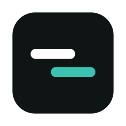
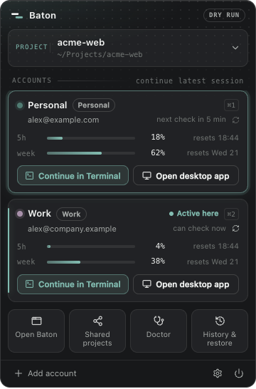
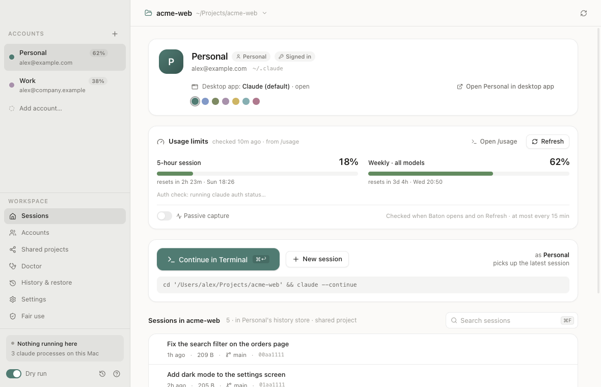
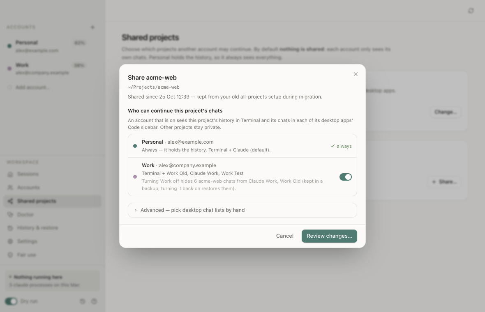
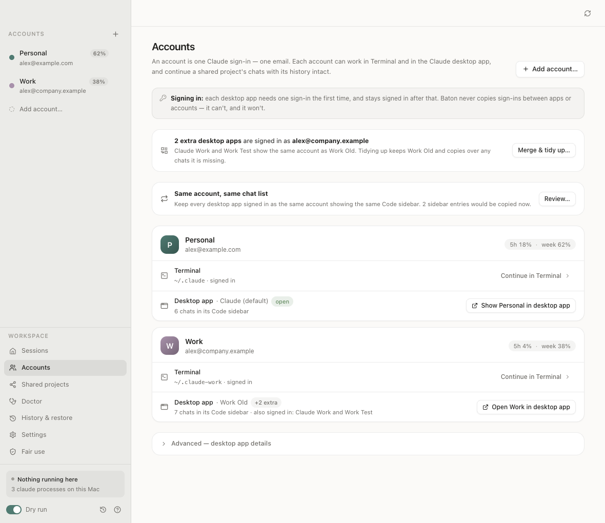
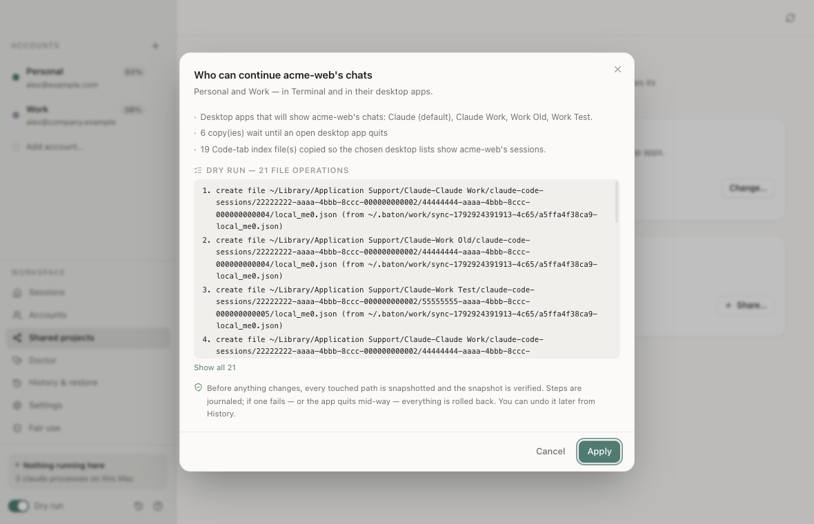
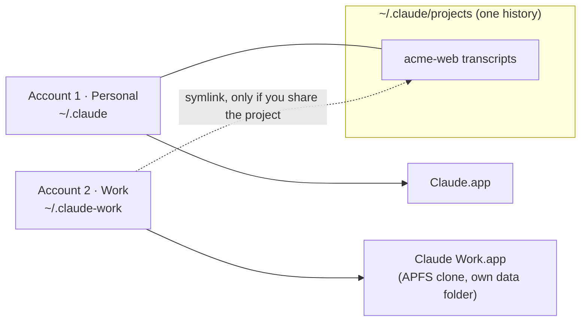

<div align="center">



<h1>Baton</h1>

<p><strong>Your Claude Code accounts. One history.</strong></p>

<p>A small, free Mac app for one person with more than one Claude account of their own —<br>
say a personal one and a work one. Continue any project, with its whole history, as whichever account fits the work.</p>

<p>
  <a href="LICENSE"></a>
  
  <a href="https://github.com/vamsijanaki/baton/releases/latest"></a>
  <a href="https://github.com/vamsijanaki/baton/actions/workflows/ci.yml"></a>
</p>

<p>
  <a href="https://github.com/vamsijanaki/baton/releases/latest"><strong>Download</strong></a> ·
  <a href="https://trybaton.app">Website</a> ·
  <a href="FAIR-USE.md">Fair use</a> ·
  <a href="https://github.com/sponsors/vamsijanaki">Sponsor</a>
</p>

<br>

<picture>
  <source media="(prefers-color-scheme: dark)" srcset="docs/screenshots/13-tray-dark.png">
  <source media="(prefers-color-scheme: light)" srcset="docs/screenshots/14-tray-light.png">
  
</picture>

<p><sub>The menu-bar panel. Pick a project, then continue it as any of your accounts.</sub></p>

</div>

---

## Why Baton

Claude Code keeps each account's history in that account's own config folder. If you have a **personal** and a **work** account on the same Mac, a project you started in one simply doesn't exist in the other — two accounts, two separate histories. And the Claude desktop app holds **one sign-in at a time**, so switching accounts means signing out and back in.

Baton puts your project history in one place and lets you choose, per project, which of your accounts may continue it. Each account gets its own desktop app, so they can sit side by side, each signed in once. You keep the right work on the right account without losing the thread.

> [!NOTE]
> Baton is for **one person using their own accounts**. It does not change what any account is entitled to, and it is not a way to get more usage. See [Fair use](#fair-use).

## Features

<table>
<tr>
<td width="50%" valign="top">

**One history, everywhere**<br>
Every transcript stays in `~/.claude/projects`. Continue or resume a project's sessions in Terminal as any account you've allowed, and see the same chats in that account's desktop app.

</td>
<td width="50%" valign="top">



</td>
</tr>
<tr>
<td valign="top">

**Per-project sharing that hides and restores**<br>
Nothing is shared by default. Turn an account on for a project and it can continue it; turn it off and that project's chats are hidden from that account's desktop apps (moved into a backup) — turn it back on and they return.

</td>
<td valign="top">



</td>
</tr>
<tr>
<td valign="top">

**A desktop app per account**<br>
Each extra account gets its own copy of Claude.app — an APFS clone with a tinted icon and its own data folder — so accounts can be open side by side. Each one needs a single sign-in, done by you, in the app.

</td>
<td valign="top">



</td>
</tr>
<tr>
<td valign="top">

**Every change previewed, snapshotted and undoable**<br>
Before anything is written you see the exact file operations. Then: a verified snapshot, a journal, step-by-step apply, verification, and automatic rollback on any failure. Every operation has a one-click **Undo**. Nothing is deleted.

</td>
<td valign="top">



</td>
</tr>
</table>

And also:

- **Usage at a glance** — the 5-hour and weekly percentages Claude Code itself reports, per account. Informational only: no limit alerts, no "switch accounts" suggestions.
- **Menu-bar panel** — pick a project, continue in Terminal or open the desktop app, see usage, jump to Doctor or History, in light and dark.
- **One writer at a time** — before opening anything, Baton checks for running `claude` processes and warns if another account is still working in the same project.
- **Doctor** — checks links, sync, app copies, disk space, interrupted operations and snapshot integrity.
- **Keyboard first** — `⌘↩` continue · `⌘F` search · `⌘1…9` account · `⌘P` project · `⌘N` add account · `⌘R` refresh · `⌘/` help.
- **Private by design** — never reads tokens or the Keychain, never modifies Claude Code or Claude.app, no servers, no telemetry.

## Install

### Download

1. Download [`Baton-arm64.dmg`](https://github.com/vamsijanaki/baton/releases/latest/download/Baton-arm64.dmg) from the [latest release](https://github.com/vamsijanaki/baton/releases/latest) (checksums in `SHA256SUMS.txt`).
2. Open it and drag **Baton** to Applications, then open Baton like any other app.

Releases are signed with a Developer ID and notarized by Apple, so macOS opens them normally.

The first Terminal launch asks for permission to control Terminal (Automation) — that's how Baton opens a Terminal window as the account you chose.

### Build from source

Requires macOS on Apple silicon, Node.js 22+, and the Xcode Command Line Tools (for a small Swift helper).

```bash
git clone https://github.com/vamsijanaki/baton.git
cd baton
npm ci
npm test              # sandboxed tests against a fake HOME — your real files are never touched
npm run dist          # → release/Baton-arm64.dmg, release/Baton-<version>-arm64-mac.zip and release/mac-arm64/Baton.app
npm run install:local # optional: copy Baton.app to ~/Applications (ad-hoc signed if you have no Developer ID)
```

<details>
<summary>Other scripts</summary>

| Script | What it does |
|---|---|
| `npm start` | Build and run the app |
| `npm run typecheck` | TypeScript check (also run in CI) |
| `npm run icons` | Render the SVG artwork to `build/icon.icns` |
| `npm run shots` | Regenerate `docs/screenshots/` from a fake HOME |
| `npm run check:real` | Read-only Doctor + migration preview against your Mac; proves nothing changed |

</details>

## How it works



- **Account 1** is your existing `~/.claude`. Baton reads it but never writes, moves or deletes anything in it.
- **Extra accounts** each get `~/.claude-<name>`, used through Claude Code's own `CLAUDE_CONFIG_DIR`. You sign in once with Claude Code's `claude auth login`.
- **Sharing a project** with an account adds one symlink: `~/.claude-<name>/projects/<project>` → `~/.claude/projects/<project>`. Credentials, `settings.json`, `.claude.json` and prompt history always stay per account.
- **Desktop chat lists.** The desktop app's Code-tab sidebar is built from small index files. For shared projects Baton keeps those in step across the chosen accounts' apps (newest wins; the other version is kept in a snapshot). Turning an account off moves that project's index files into `~/.baton/hidden/`; turning it on restores them.
- **Usage** comes from Claude Code's built-in `/usage` command (no model call, zero tokens) — only when Baton opens and when you press Refresh, at most once per 15 minutes per account, never in a background loop. An optional per-account status line can keep it fresh for free; enabling it touches only that account's `statusLine` setting, backed up for undo.
- **Safety engine** (`electron/safety.ts`): plan → dry-run preview → confirm → running-app check → snapshot → verify snapshot → journal → apply → verify → automatic rollback. A hard guard refuses any write to `~/.claude`, any delete or overwrite of a transcript, anything inside `/Applications/Claude.app`, and anything in a desktop app's data folder other than its Code-tab index files. Removed items are unlinked (symlinks only), quarantined in a snapshot, moved to the hidden backup, or moved to the macOS Trash.

<details>
<summary>Where Baton keeps its own files</summary>

| What | New install | Installed before the rename (as "Claude Switch") |
|---|---|---|
| State, journal, snapshots, hidden backups, launch scripts, usage | `~/.baton` | `~/.claude-switch` (kept and used as is) |
| Desktop app copies | `~/Library/Application Support/Baton/apps` | `~/Library/Application Support/claude-switch/apps` (kept) |
| Window and appearance preferences | `~/Library/Application Support/Baton` | `~/Library/Application Support/Claude Switch` (kept) |

Baton never moves or deletes these folders by itself.

</details>

## Fair use

Baton is for **one person** using **their own** Claude accounts on **their own Mac**. It is not a way around usage limits, bans or sharing rules.

| Do | Don't |
|---|---|
| Use it alone, with accounts that are yours | Share accounts or let others use yours |
| Use the right account for the right work (personal vs. employer) | Buy several personal plans to rotate past usage limits |
| Follow your employer's policy for work accounts and code | Continue with another account after one is suspended or banned |
| | Resell or proxy access, or modify Claude Code |

The app backs this up: it asks you to confirm each account is yours and only you use it; a second Personal plan needs an explicit "not to get around usage limits" confirmation; sharing into or out of a Work account shows a policy note; and an account Claude Code reports as suspended is marked **Suspended** and can't have its projects continued elsewhere. Account kind is detected from non-secret fields only. Baton has no export or sync of sessions to other people or machines — history stays on this Mac.

Read the full text in [FAIR-USE.md](FAIR-USE.md) (also in the app under **Fair use**), and Anthropic's own pages: [Usage Policy](https://www.anthropic.com/legal/aup) · [Consumer Terms](https://www.anthropic.com/legal/consumer-terms) · [Claude Code legal and compliance](https://code.claude.com/docs/en/legal-and-compliance). Not legal advice.

## FAQ

<details>
<summary><strong>Is this allowed?</strong></summary>

Baton is for one person using their own accounts on their own Mac — for example keeping personal and work use separate while still continuing your own project's history. It signs in only through Claude Code's and the Claude app's own sign-in flows and never shares or copies sign-ins. Don't use it to share an account, to rotate personal plans past their usage limits, or to keep working with another account after one is suspended. See [Fair use](#fair-use).

</details>

<details>
<summary><strong>Does it read my tokens?</strong></summary>

No. Baton never reads, copies or stores credentials, and never touches the Keychain. From an account's `.claude.json` it reads only the email, account id and the non-secret plan/organization type fields, to label accounts and tell Personal from Work. At start-up it clears any inherited `CLAUDE_*`/`ANTHROPIC_*` variables from its own environment so each `claude` it starts uses exactly the account you picked. Diagnostics exports are redacted (no tokens, no chat content, emails masked).

</details>

<details>
<summary><strong>Does it upload anything?</strong></summary>

No. Baton has no server and no telemetry. Everything stays on your Mac, and the source is here to check.

</details>

<details>
<summary><strong>What happens to a project's chats when I turn an account off?</strong></summary>

That account's Terminal link to the project is removed, and the project's chats are hidden from that account's desktop apps (moved into a backup, never deleted). Turn it back on and they come back. Transcripts in `~/.claude/projects` are never touched, and account 1 always sees everything.

</details>

<details>
<summary><strong>Can two accounts work on the same project at once?</strong></summary>

Please don't — two writers on one transcript interleave. Baton warns you when another account is still running in the project and offers to show or quit it (it asks first).

</details>

<details>
<summary><strong>Intel Macs, Windows, Linux?</strong></summary>

The release is an Apple silicon build. An Intel build may work from source (`electron-builder --mac --x64`) but is untested. Windows and Linux are not supported.

</details>

<details>
<summary><strong>Known limits</strong></summary>

- A **running** desktop app picks up synced chats after it restarts (writes to it wait until it quits).
- Prompt up-arrow history (`history.jsonl`) stays per account.
- Removing an account doesn't touch the Keychain; its sign-in item may stay there.
- Terminal launches use Terminal.app.

</details>

## Sponsor

Baton is free and MIT-licensed, and will stay that way. If it saves you time, [sponsoring on GitHub](https://github.com/sponsors/vamsijanaki) helps:

- **Keep Baton free** for everyone, with no paid tier and no telemetry.
- **Cover the Apple Developer ID** ($99/year) that keeps releases signed and notarized.
- **Fund maintenance** — keeping up with Claude Code and desktop-app changes, macOS releases, and fixes.

<a href="https://github.com/sponsors/vamsijanaki"></a>

## Contributing & security

Contributions are welcome — read [CONTRIBUTING.md](CONTRIBUTING.md) first (the bar is: never lose or leak anyone's data). Please report vulnerabilities privately as described in [SECURITY.md](SECURITY.md), not in a public issue.

## License

[MIT](LICENSE) © 2026 Vamsi Janaki

<sub>Not affiliated with or endorsed by Anthropic. Claude is a trademark of Anthropic.</sub>
