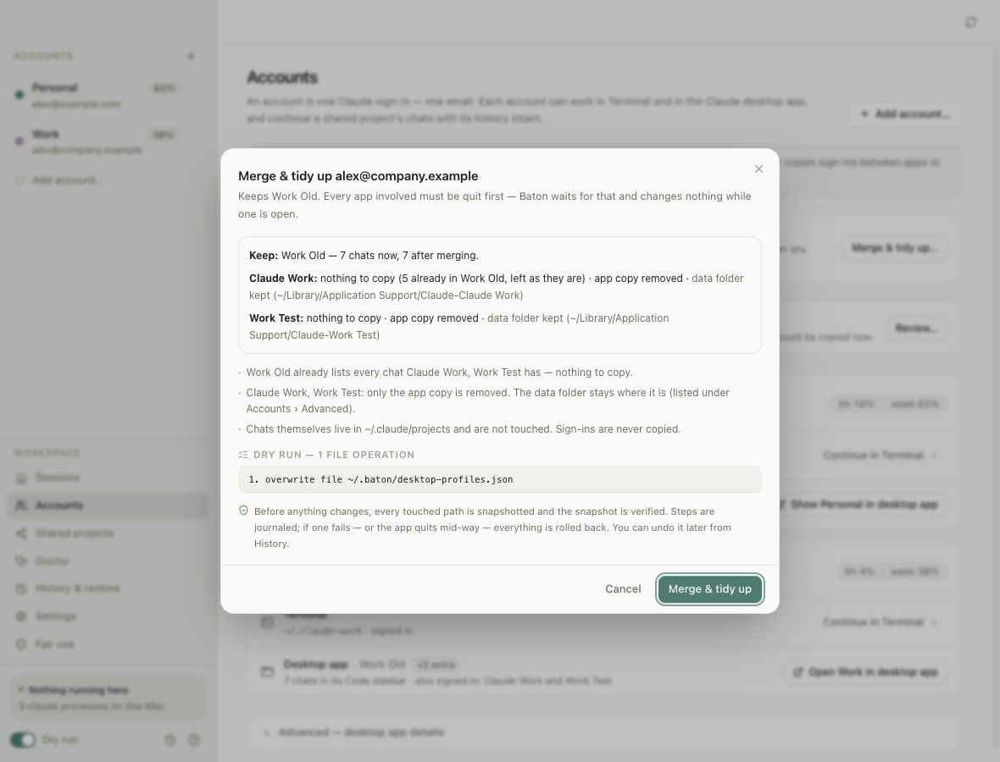
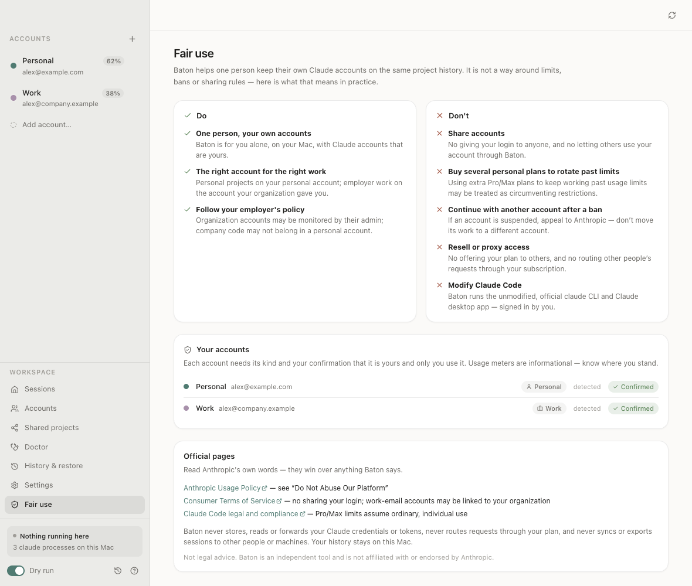
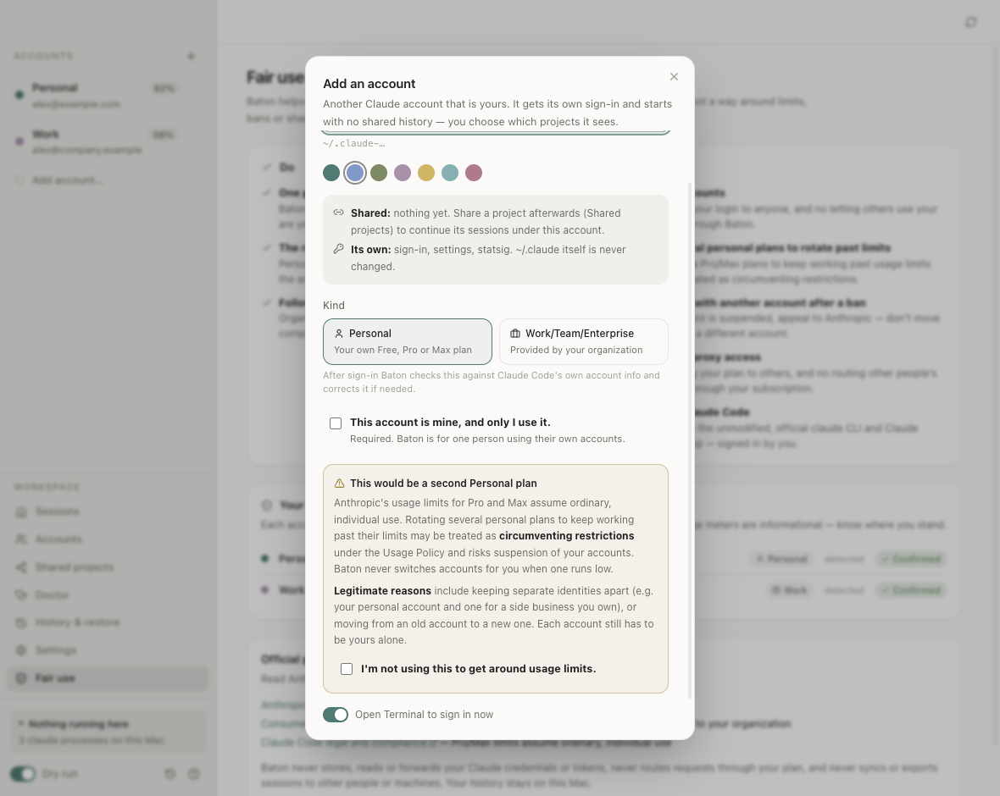

# Baton

**Your Claude Code accounts, one history.**

Baton is a small macOS app for people who use more than one of their **own** Claude Code accounts — say a personal account and a work account — on the same Mac. It keeps one conversation history per project, lets you pick which of your accounts may continue which project, and opens Terminal or the Claude desktop app as the account you choose. Nothing is lost, nothing is uploaded, and every change it makes can be previewed and undone.

> Baton is an independent open-source project. It is **not affiliated with, endorsed by or supported by Anthropic**. "Claude" and "Claude Code" are used only to describe what Baton works with.


| Sessions | Who can continue a project |
|---|---|
|  |  |

| Every change is previewed first | Tidy up duplicate desktop apps |
|---|---|
|  |  |

| Fair use, in the app | A second Personal plan asks first |
|---|---|
|  |  |

## Why

Claude Code keeps each account's history in its own config folder. If you have a personal and a work account, a project you started in one is invisible in the other, and the desktop app can only be signed in to one account at a time. Baton gives you:

- **One history per project.** Every transcript stays in `~/.claude/projects`. You choose, per project, which other accounts may continue it.
- **One card per account.** An account is one sign-in (one email). Its card shows where it works: Terminal (its config folder) and its desktop app.
- **A desktop app per account**, so your accounts can be open side by side, each signed in once.
- **Usage at a glance.** The 5-hour and weekly usage that Claude Code itself reports, per account — informational only, so you know where you stand.
- **Safety first.** Previews, snapshots, a journal, automatic rollback and undo for every change.
- **Fair use built in.** One person, own accounts. See [Fair use](#fair-use).

## What it does

| Piece | What it does |
|---|---|
| **Account 1** | Your existing `~/.claude`. It is read, never written, moved or deleted. |
| **Extra accounts** | Each gets `~/.claude-<name>`, used through Claude Code's `CLAUDE_CONFIG_DIR`. You sign in once, in Terminal, with Claude Code's own `claude auth login`. |
| **Shared projects** | Opt-in, per project. Sharing a project with an account adds one link `~/.claude-<name>/projects/<project>` → `~/.claude/projects/<project>`. Nothing is shared by default. |
| **Never shared** | Credentials (Keychain), `settings.json`, `.claude.json` and prompt history stay per account. |
| **Desktop apps** | Each extra account gets its own copy of Claude.app (an APFS clone with a tinted icon and its own data folder, launched with `--user-data-dir`). Every desktop app needs one sign-in the first time. Baton never copies sign-ins. |
| **Desktop chat lists** | The Code-tab sidebar of a desktop app is built from small index files. For a shared project, Baton keeps those lists in step across the desktop apps of the accounts you chose (two-way, newest wins, the other version kept in a snapshot). **Turning an account off for a project hides that project's chats from that account's desktop apps**: the index files move into a backup (`hidden/` in Baton's folder, with a manifest). **Turning it back on restores them.** Account 1's apps always keep every chat, and transcripts themselves are never touched. |
| **One at a time** | Before it opens anything, Baton looks for running `claude` processes. If another account is still working in the same project, it says so and lets you show or quit it (it asks first). |
| **Sessions** | Lists a project's sessions (title, time, size, git branch) and resumes one as the account you pick. |
| **Usage** | Runs Claude Code's own `/usage` command for an account (no model call, zero tokens) and shows the 5-hour and weekly percentages — only when Baton opens and when you press Refresh, at most once per 15 minutes per account, never in a background loop. Optional per-account status-line capture keeps it fresh for free. Informational only: Baton never notifies about limits, never suggests or switches to another account when one runs low. |

Keyboard: `⌘↩` continue/resume · `⌘F` search · `⌘1…9` account · `⌘P` project · `⌘N` add account · `⌘R` refresh · `⌘/` help.

## Fair use

Baton is for **one person** using **their own** Claude accounts on **their own Mac**. It is not a way around usage limits, bans or sharing rules. Full text: [FAIR-USE.md](FAIR-USE.md) (also in the app: sidebar › **Fair use**).

| Do | Don't |
|---|---|
| Use it alone, with accounts that are yours | Share accounts or let others use yours |
| Use the right account for the right work (personal vs. employer) | Buy several personal plans to rotate past usage limits |
| Follow your employer's policy for work accounts and code | Continue with another account after one is suspended or banned |
| | Resell or proxy access, or route others' requests through your plan |
| | Modify Claude Code — Baton runs the official, unmodified `claude` |

What the app enforces:

- **Account kind.** Each account is *Personal (Free/Pro/Max)* or *Work/Team/Enterprise (organization-provided)*. Baton detects it from non-secret fields only (`subscriptionType` from `claude auth status`, and `organizationType`/`billingType` in `.claude.json`'s `oauthAccount`) and asks you when they don't say. It never reads tokens, credentials or the Keychain.
- **Ownership.** Adding (or first using) an account requires ticking *"This account is mine, and only I use it."* The time is recorded.
- **A second Personal plan** shows a warning that rotating personal plans past their limits may be treated as circumventing restrictions, and requires *"I'm not using this to get around usage limits."*
- **Work accounts.** Sharing a project into a Work account notes that your organization's admin may be able to see those chats; sharing from a Work account into a Personal one notes it may move your employer's code/data — check your company's policy.
- **Suspended accounts.** When Claude Code clearly reports that an account is suspended or disabled, Baton marks it *Suspended* and refuses to continue its projects in another account (that would violate the Usage Policy), and links to [Anthropic support](https://support.anthropic.com) to appeal.
- **Single person, single Mac.** Baton has no export or sync of sessions to other people or machines. History stays in `~/.claude/projects` on this Mac.

Official pages: [Usage Policy](https://www.anthropic.com/legal/aup) · [Consumer Terms](https://www.anthropic.com/legal/consumer-terms) · [Claude Code legal and compliance](https://code.claude.com/docs/en/legal-and-compliance). Not legal advice. Not affiliated with Anthropic.

## Safety model

Every write Baton makes goes through one engine (`electron/safety.ts`):

**plan → dry-run preview (the exact file operations) → confirm → running-process check → snapshot → verify the snapshot → journal → apply step by step → verify → automatic rollback on any failure.**

- **Snapshots**: a `data.tar.gz` plus a manifest (type, size, sha256 and link target of every path). The archive is extracted and re-hashed before anything changes; a mismatch aborts.
- **Journal**: each operation's steps, pre-state and progress. If Baton or your Mac stops mid-way, the next start rolls the operation back.
- **Never deletes your data.** Removed items are unlinked (symlinks only), moved into a snapshot's quarantine, moved into the `hidden/` backup, or moved to the macOS Trash. A hard guard refuses any write to `~/.claude`, any delete or overwrite of a transcript in `~/.claude/projects`, anything inside `/Applications/Claude.app`, and anything in a desktop app's data folder other than its Code-tab index files.
- **Running apps are respected**: an operation that touches an account or desktop app that is running waits until it quits.
- **History & restore**: every operation has **Undo**, itself previewed and snapshotted. **Doctor** checks links, sync, app copies, disk space, interrupted operations and snapshot integrity.
- **Dry run** (toggle, or `BATON_DRY_RUN=1`): every command is logged and nothing runs.

### Where Baton keeps its own files

| What | New install | Installed before the rename (as "Claude Switch") |
|---|---|---|
| State, journal, snapshots, hidden backups, launch scripts, usage | `~/.baton` | `~/.claude-switch` (kept and used as is) |
| Desktop app copies | `~/Library/Application Support/Baton/apps` | `~/Library/Application Support/claude-switch/apps` (kept) |
| Window and appearance preferences | `~/Library/Application Support/Baton` | `~/Library/Application Support/Claude Switch` (kept) |

Baton never moves or deletes these folders by itself. If the old folder exists it simply keeps using it.

## Install

### Download

Download `Baton-<version>-arm64.dmg` from [Releases](https://github.com/vamsijanaki/baton/releases), open it and drag **Baton** to Applications.

The build is ad-hoc signed but **not notarized** — notarization needs a paid Apple Developer ID. The first time, macOS Gatekeeper will refuse to open it. Either **right-click Baton.app → Open → Open**, or (on newer macOS versions, where that is not offered) try to open it once, then go to **System Settings › Privacy & Security** and click **Open Anyway**. You only need to do this once. If you prefer, build it from source instead.

The first Terminal launch asks for permission to control Terminal (Automation); that is how Baton opens a Terminal window as the account you chose.

### Build from source

Requirements: macOS on Apple silicon, Node.js 22+, Xcode Command Line Tools (for the small Swift helper).

```bash
git clone https://github.com/vamsijanaki/baton.git
cd baton
npm ci
npm test              # sandboxed tests (a fake HOME; your real files are never touched)
npm run dist          # → release/Baton-<version>-arm64.dmg and release/mac-arm64/Baton.app
npm run install:local # optional: ad-hoc sign and copy Baton.app to ~/Applications
```

If you used the app under its old name, `install:local` leaves `~/Applications/Claude Switch.app` where it is and prints the command to move it to the Trash when you are ready.

Other scripts: `npm start` (build and run), `npm run typecheck`, `npm run icons` (SVG → `build/icon.icns`), `npm run shots` (screenshots from a fake HOME into `docs/screenshots/`), `npm run check:real` (read-only Doctor + migration preview against your Mac; proves nothing changed).

## FAQ

**Is this allowed?**
Baton is for one person using their own accounts on their own Mac — for example keeping personal and work use separate while still being able to continue your own project's history. It signs in only through Claude Code's and the Claude app's own sign-in flows and never shares or copies sign-ins. Do not use it to share an account with other people, to rotate several personal plans past their usage limits, or to keep working with another account after one is suspended — see [Fair use](#fair-use). Baton is a convenience for organising your own work; it does not change what any account is entitled to.

**Does it read my tokens?**
No. Baton never reads, copies or stores credentials. It reads only the email, account id and the non-secret plan/organization type fields from an account's `.claude.json` to show which account is which and whether it is Personal or Work. When it starts, it also removes any inherited `CLAUDE_*`/`ANTHROPIC_*` variables from its own environment so that each `claude` it starts uses exactly the account you picked. Diagnostics exports are redacted (no tokens, no chat content, emails masked).

**Does it upload anything?**
No. Baton has no server and no telemetry. Everything stays on your Mac.

**What happens to a project's chats when I turn an account off?**
That account's Terminal link to the project is removed, and the project's chats are hidden from that account's desktop apps (moved into a backup, never deleted). Turn the account back on and they come back. Transcripts in `~/.claude/projects` are never touched, and account 1 always sees everything.

**Can two accounts work on the same project at the same time?**
Please don't: two writers on one transcript interleave. Baton warns you when another account is still running on the project.

**Does it work on Intel Macs / Windows / Linux?**
It is built and tested on Apple silicon macOS. Intel builds may work from source (`electron-builder --mac --x64`) but are untested. Windows and Linux are not supported.

## Known limits

- A **running** desktop app picks up synced chats after it restarts (writes to it wait until it quits).
- Prompt up-arrow history (`history.jsonl`) stays per account.
- Removing an account does not touch the Keychain; its sign-in item may stay there.
- Terminal launches use Terminal.app.

## Contributing & security

See [CONTRIBUTING.md](CONTRIBUTING.md) and [SECURITY.md](SECURITY.md).

## License

[MIT](LICENSE) © 2026 Vamsi Janaki
